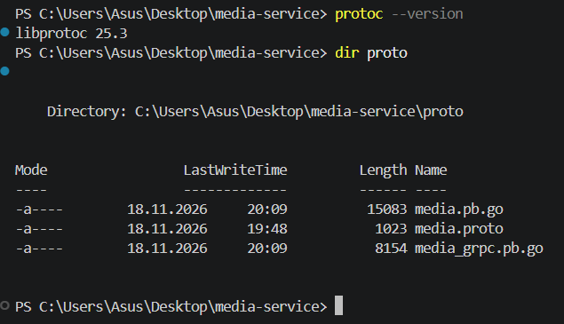
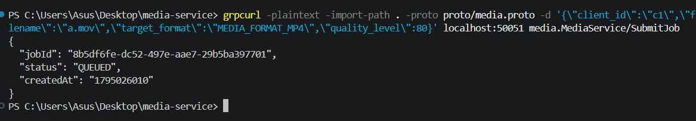
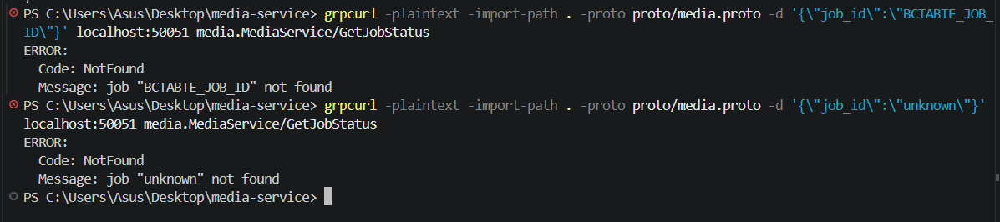
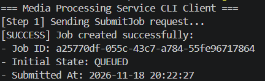
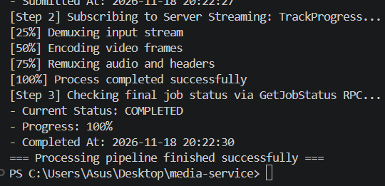

# Практична робота №7 — Media Processing Service (gRPC)

**Тема:** Реалізація міжсервісної взаємодії за протоколом gRPC

Внутрішній мікросервіс обробки медіафайлів на Go, взаємодія з яким відбувається за протоколом gRPC.
Реалізовано **Рівень 1** (Unary RPC) та **Рівень 2** (Server Streaming + консольний клієнт).
Рівень 3 (interceptors, metadata) за завданням не виконувався.

## Структура проєкту

```
media-service/
├── go.mod
├── proto/
│   ├── media.proto          # контракт Protobuf (proto3)
│   ├── media.pb.go          # згенеровано protoc-gen-go
│   └── media_grpc.pb.go     # згенеровано protoc-gen-go-grpc
├── cmd/
│   ├── server/main.go       # gRPC-сервер (:50051)
│   └── client/main.go       # консольний клієнт
└── screenshots/             # скриншоти роботи
```

## Контракт

- `SubmitJob(ProcessMediaRequest) returns (JobResponse)` — реєстрація завдання, статус `QUEUED`, UUID v4.
- `GetJobStatus(GetJobStatusRequest) returns (JobStatusResponse)` — статус за `job_id`, `codes.NotFound`, якщо завдання немає.
- `TrackProgress(GetJobStatusRequest) returns (stream ProgressUpdate)` — Server Streaming: 25 %, 50 %, 75 %, 100 %.

Сервер зберігає завдання в пам'яті (`map` + `sync.RWMutex`), на 100 % ставить статус `COMPLETED`
і зупиняється при скасуванні контексту клієнта (`stream.Context().Done()`).
Запит валідується: порожнє `filename`, `MEDIA_FORMAT_UNSPECIFIED` або `quality_level` поза 1..100 дають `InvalidArgument`.

## Вимоги

- Go 1.22+
- `protoc`
- Плагіни:
  ```bash
  go install google.golang.org/protobuf/cmd/protoc-gen-go@latest
  go install google.golang.org/grpc/cmd/protoc-gen-go-grpc@latest
  ```
  Каталог `$(go env GOPATH)/bin` має бути в `PATH`.

## Запуск

```bash
# 1. Залежності
go mod tidy

# 2. Кодогенерація
protoc --go_out=. --go_opt=paths=source_relative \
       --go-grpc_out=. --go-grpc_opt=paths=source_relative \
       proto/media.proto

# 3. Термінал 1 — сервер
go run ./cmd/server

# 4. Термінал 2 — клієнт
go run ./cmd/client
```

## Тестування через grpcurl (Рівень 1)

Reflection не підключено, тому вказується файл контракту.

**Windows PowerShell** (лапки в JSON екрануються як `\"`):

```powershell
grpcurl -plaintext -import-path . -proto proto/media.proto -d '{\"client_id\":\"c1\",\"filename\":\"a.mov\",\"target_format\":\"MEDIA_FORMAT_MP4\",\"quality_level\":80}' localhost:50051 media.MediaService/SubmitJob

grpcurl -plaintext -import-path . -proto proto/media.proto -d '{\"job_id\":\"<JOB_ID>\"}' localhost:50051 media.MediaService/GetJobStatus

# негативний сценарій — очікується NotFound
grpcurl -plaintext -import-path . -proto proto/media.proto -d '{\"job_id\":\"unknown\"}' localhost:50051 media.MediaService/GetJobStatus
```

**bash / zsh:**

```bash
grpcurl -plaintext -import-path . -proto proto/media.proto \
  -d '{"client_id":"c1","filename":"a.mov","target_format":"MEDIA_FORMAT_MP4","quality_level":80}' \
  localhost:50051 media.MediaService/SubmitJob

grpcurl -plaintext -import-path . -proto proto/media.proto \
  -d '{"job_id":"<JOB_ID>"}' \
  localhost:50051 media.MediaService/GetJobStatus

grpcurl -plaintext -import-path . -proto proto/media.proto \
  -d '{"job_id":"unknown"}' \
  localhost:50051 media.MediaService/GetJobStatus
```

## Скриншоти

### 1. Кодогенерація protoc



### 2. Запуск сервера


### 3. grpcurl / Postman: SubmitJob



### 4. grpcurl / Postman: GetJobStatus (успіх і NotFound)



### 5. Робота клієнта (Server Streaming)



### 6. Логи сервера під час стрімінгу



## Очікуваний вивід клієнта

```
=== Media Processing Service CLI Client ===
[Step 1] Sending SubmitJob request...
[SUCCESS] Job created successfully:
- Job ID: 9b3c4a12-8871-4a8e-b3f9-7104b2c129e1
- Initial State: QUEUED
- Submitted At: 2026-11-18 19:55:15
[Step 2] Subscribing to Server Streaming: TrackProgress...
[25%] Demuxing input stream
[50%] Encoding video frames
[75%] Remuxing audio and headers
[100%] Process completed successfully
[Step 3] Checking final job status via GetJobStatus RPC...
- Current Status: COMPLETED
- Progress: 100%
- Completed At: 2026-11-18 19:55:18
=== Processing pipeline finished successfully ===
```

## Висновки

Під час виконання практичної роботи було розроблено внутрішній мікросервіс обробки медіафайлів, взаємодія з яким відбувається виключно за протоколом gRPC.

1. Описано контракт `proto/media.proto` на мові proto3: перелічуваний тип `MediaFormat` із нульовим значенням `UNSPECIFIED`, повідомлення запитів і відповідей та сервіс `MediaService`. Файл `.proto` став єдиним джерелом правди для клієнта й сервера.
2. За допомогою `protoc` із плагінами `protoc-gen-go` та `protoc-gen-go-grpc` згенеровано Go-структури, серверний інтерфейс і клієнтський стаб, тож ручне кодування серіалізації не знадобилося.
3. Реалізовано сервер із двома Unary-методами. Завдання зберігаються в пам'яті під захистом `sync.RWMutex`, для кожного генерується UUID. Помилки повертаються стандартними gRPC-кодами: `NotFound` для невідомого завдання та `InvalidArgument` для некоректного запиту.
4. Реалізовано Server Streaming (`TrackProgress`): сервер поетапно надсилає клієнту прогрес обробки через `stream.Send()`, на 100 % змінює статус завдання на `COMPLETED`, а скасування клієнтського контексту (`stream.Context().Done()`) негайно зупиняє обробку й запобігає витоку горутин.
5. Створено консольний клієнт на базі `grpc.NewClient`, який послідовно реєструє завдання, читає потік повідомлень до `io.EOF` і перевіряє фінальний стан через `GetJobStatus`.
6. Unary-методи додатково перевірено інструментом grpcurl, зокрема негативний сценарій із кодом `NotFound`.

Порівняно з REST gRPC дає компактну бінарну серіалізацію, строгу типізацію на етапі компіляції, мультиплексування через HTTP/2 та вбудовану підтримку потоків. Недоліками є складніше налагодження (бінарний формат, потрібні спеціальні інструменти) та обмежена підтримка у браузерах без проксі. Для внутрішньої взаємодії мікросервісів ці недоліки несуттєві, тому gRPC добре підходить для такого завдання.

Рівень 3 (автентифікація через metadata та Unary Interceptors) за умовою не виконувався. Його можна додати без зміни контракту, підключивши перехоплювач під час створення сервера.

## Відповіді на контрольні питання

### 1. У чому полягають ключові відмінності gRPC від REST over HTTP/1.1?

- **Транспорт:** gRPC працює поверх HTTP/2 (мультиплексування кількох запитів в одному TCP-з'єднанні, стиснення заголовків), REST класично використовує HTTP/1.1, де запити на одному з'єднанні обробляються послідовно.
- **Формат даних:** gRPC використовує бінарний Protocol Buffers, REST — текстовий JSON. Protobuf компактніший і швидший у серіалізації.
- **Модель:** gRPC — це виклик віддалених процедур (`SubmitJob`), REST — робота з ресурсами через HTTP-методи (`POST /jobs`).
- **Контракт:** у gRPC суворий контракт `.proto`, з якого генеруються клієнт і сервер. У REST схема (OpenAPI) необов'язкова й часто розходиться з реалізацією.
- **Потоки:** gRPC має вбудовані клієнтські, серверні та двонапрямлені потоки. У REST для цього потрібні обхідні рішення (SSE, WebSocket, довгі опитування).
- **Помилки:** gRPC має власний набір кодів статусу (`NotFound`, `Unauthenticated` тощо).
- **Обмеження:** браузери не підтримують gRPC напряму (потрібен grpc-web), а відповіді важче читати без спеціальних інструментів.

### 2. Яку роль відіграють номери полів у Protocol Buffers? Чому їх не можна змінювати після випуску сервісу?

У бінарному форматі передаються не імена полів, а їхні номери (теги) разом із типом кодування. За номером приймач розуміє, яке поле в повідомленні він читає. Тому номер є ідентичністю поля.

Якщо змінити номер вже використовуваного поля, старі клієнти або збережені дані будуть інтерпретуватися як інше поле, що призведе до помилкових даних або збою розбору. Видалені поля слід позначати `reserved`, щоб їхній номер не використали повторно. Номери 1–15 кодуються одним байтом, тому їх варто віддавати часто вживаним полям.

### 3. Чим відрізняються скалярні типи від enum? Чому перше значення enum у proto3 має бути 0?

Скалярні типи (`int32`, `string`, `bool`, `int64` тощо) містять довільне значення відповідного типу. Enum — це набір іменованих цілочисельних констант, який обмежує змістовні значення переліком і робить код читабельнішим (`MEDIA_FORMAT_MP4` замість `4`).

У proto3 відсутнє поле набуває значення за замовчуванням — для enum це значення з номером 0. Тому перший елемент обов'язково має мати індекс 0, а за домовленістю його називають `UNSPECIFIED`: це дозволяє відрізнити «значення не задано» від реального вибору. Також це забезпечує сумісність із proto2.

### 4. Які існують чотири типи RPC у gRPC? Де застосовується Server Streaming?

1. **Unary** — один запит, одна відповідь.
2. **Server Streaming** — один запит, потік відповідей.
3. **Client Streaming** — потік запитів, одна відповідь.
4. **Bidirectional Streaming** — потоки в обидва боки одночасно.

Server Streaming застосовується, коли сервер має поступово повертати дані: відстеження прогресу тривалої операції (як у цій роботі), стрічка подій і сповіщень, котирування бірж, перегляд логів у реальному часі, передача великого набору результатів частинами, завантаження файлу шматками.

### 5. Як gRPC-сервер повертає помилки? Чому не варто повертати їх рядками в тілі відповіді?

Метод повертає значення типу `error`, зазвичай створене через `status.Error(code, msg)` або `status.Errorf`. Клієнт отримує стандартизований код (`codes.NotFound`, `codes.InvalidArgument`, `codes.Unauthenticated` тощо), текстове повідомлення і за потреби додаткові деталі. Передаються вони в трейлерах HTTP/2 (`grpc-status`, `grpc-message`), а на клієнті розбираються через `status.FromError(err)`.

Повернення помилки звичайним рядком у тілі відповіді небажане, бо:
- клієнт не може програмно розпізнати тип помилки без розбору тексту;
- змішуються успішні й неуспішні відповіді, а транспорт вважає виклик успішним;
- перехоплювачі, метрики та механізми повторних спроб (retry) не бачать помилок;
- немає єдиного стандарту для всіх сервісів і мов.

### 6. Що таке gRPC Metadata і які заголовки HTTP/2 для неї використовуються?

Metadata — це пари «ключ — значення», які передаються разом із викликом незалежно від тіла повідомлення: токени авторизації, ідентифікатори запиту, інформація для трасування. Вони пересилаються як звичайні заголовки HTTP/2 (початкові) і трейлери (завершальні). Ключі нечутливі до регістру й записуються малими літерами, наприклад `authorization` або `x-api-key`. Ключі, що закінчуються на `-bin`, містять бінарні значення в кодуванні base64.

Власні ключі метаданих передаються як окремі заголовки HTTP/2. Крім них, gRPC використовує службові: псевдозаголовки `:method`, `:path`, `:authority`, а також `content-type: application/grpc`, `grpc-timeout`, `te: trailers` та у відповіді `grpc-status` і `grpc-message`. Імена, що починаються на `grpc-`, зарезервовані. У Go метадані читаються через `metadata.FromIncomingContext(ctx)`, а передаються через `metadata.NewOutgoingContext`.

### 7. Як влаштовані Unary Interceptors у Go і як вони реалізують наскрізні вимоги?

Unary Interceptor — це функція з сигнатурою `func(ctx, req, info *grpc.UnaryServerInfo, handler grpc.UnaryHandler) (any, error)`, яка «обгортає» виклик методу сервера. Її реєструють при створенні сервера: `grpc.NewServer(grpc.UnaryInterceptor(...))`. Для кількох перехоплювачів використовують `grpc.ChainUnaryInterceptor`.

Усередині перехоплювач може виконати дії **до** виклику (перевірити метадані й токен, залогувати початок, записати час), потім викликати `handler(ctx, req)`, передавши керування наступній ланці або самому методу, а після повернення виконати дії **після** (обчислити тривалість, зафіксувати код статусу, зібрати метрику). Також він може перервати виклик, повернувши помилку (наприклад, `Unauthenticated`), і тоді метод не буде виконано.

Це аналог middleware: логіка автентифікації, логування, метрик, відновлення після паніки, трасування пишеться один раз і застосовується до всіх методів без дублювання коду в кожному обробнику.

### 8. Чому важливо відстежувати `stream.Context().Done()` у потокових методах?

Контекст потоку скасовується, коли клієнт перериває виклик, спливає таймаут (deadline) або розривається з'єднання. Якщо сервер не перевіряє `Done()`, горутина продовжить виконувати роботу й намагатиметься надсилати дані клієнту, якого вже немає. Це призводить до витоку горутин, марних витрат процесорного часу й пам'яті та зайнятих ресурсів (з'єднань, файлів, блокувань).

Перевірка в `select` разом із очікуванням наступного кроку (`time.After`) дозволяє негайно зупинити обробку, коректно звільнити ресурси й повернути `codes.Canceled`. У цій роботі саме так реалізовано метод `TrackProgress`.
